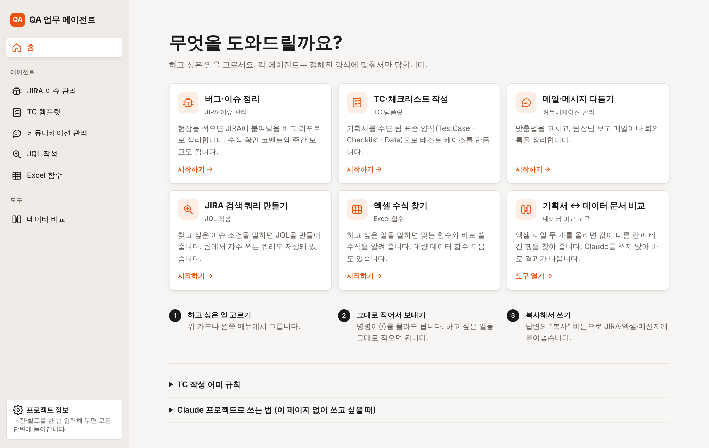
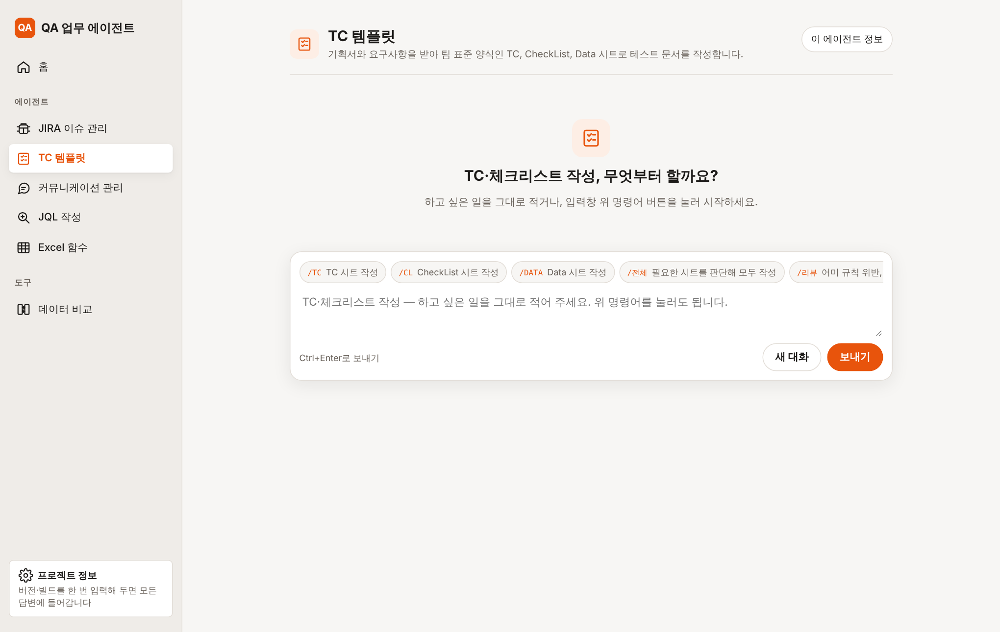
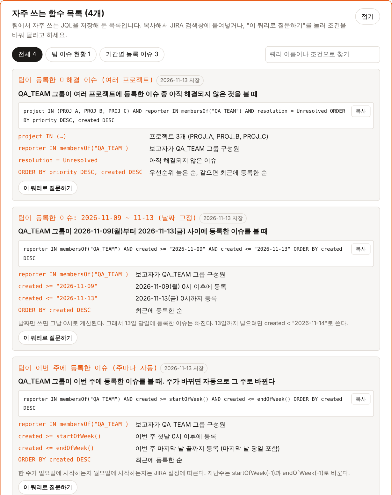
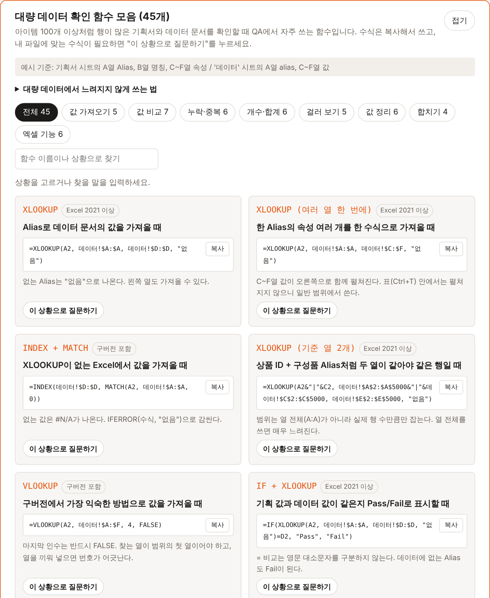
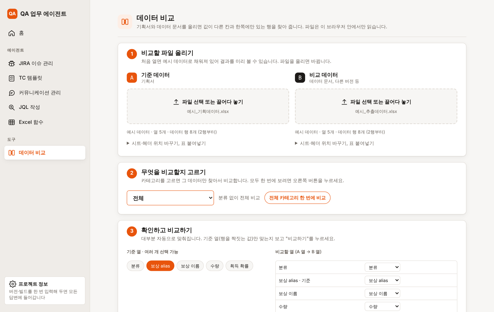

# QA 업무 에이전트

게임 QA 실무에서 반복되는 문서 작업을 줄이기 위해 만든 **Claude 기반 업무 에이전트 5종 + 데이터 비교 도구**입니다.

- **문제:** 버그 리포트·TC·보고 메일·JQL·엑셀 수식을 매번 손으로 쓰다 보니 사람마다 형식이 달라지고, 100개 이상 아이템의 기획서↔데이터 문서 대조에 시간이 많이 들었습니다.
- **만든 것:** 팀 양식과 문장 규칙을 지침으로 고정한 에이전트 5종과, 기획서와 데이터 문서의 차이를 브라우저에서 바로 찾는 비교 도구를 한 페이지에 묶었습니다.
- **결과:** 누가 써도 같은 형식(TC 어미 규칙, JIRA 템플릿)으로 결과가 나오고, 데이터 대조는 파일 두 개만 올리면 다른 칸·누락 행·JIRA 이슈 문구까지 한 번에 나옵니다.



> 공개용 사본입니다. 실제 업무에서 쓰던 프로젝트·팀 정보와 예시 문장은 모두 빼고, 가상 값(`PROJ_A`, `QA_TEAM` 등)과 일반 예시로 바꿨습니다.

---

## 구성

| 구분 | 이름 | 하는 일 |
|---|---|---|
| 에이전트 01 | JIRA 이슈 관리 | 현상 메모 → 버그 리포트, 수정 확인 코멘트, 이슈 현황·주간 보고 |
| 에이전트 02 | TC 템플릿 | 기획서 → TestCase · Checklist · Data 시트 형식의 테스트 케이스 |
| 에이전트 03 | 커뮤니케이션 관리 | 맞춤법·문장 교정, 보고 메일, 회의록, 전달사항 정리 |
| 에이전트 04 | JQL 작성 | 조건 → JQL 작성·해석·개선, 팀 저장 쿼리 목록 |
| 에이전트 05 | Excel 함수 | 상황 → 함수 추천, 대량 데이터 확인 함수 45종 모음 |
| 도구 06 | 데이터 비교 | 기획서(A)와 데이터 문서(B)의 값 차이·누락 행 찾기 (Claude 호출 없음) |

## 설계 원칙

1. **형식은 지침이 정한다.** 에이전트마다 "답해도 되는 범위"와 "출력 형식"을 지침에 고정해, 질문이 달라도 결과물 모양은 같게 했습니다. 범위 밖 요청은 담당 에이전트를 안내합니다.
2. **팀 문장 규칙을 그대로 지킨다.** TC 작성 시 아래 어미 규칙을 강제합니다.

   | 항목 | 어미 | 예 |
   |---|---|---|
   | Precondition | ~상태 | 우편함에 보상 우편이 1개 이상 있는 상태 |
   | Test Step | ~확인 | 우편함에서 보상 수령 확인 |
   | Expected Result | ~다. | 보상 수령 후 해당 우편이 우편함 목록에서 삭제된다. |
   | Checklist 확인항목 | ~확인 | 우편 보상 수령 시 인벤토리 수량 증가 확인 |
   | 참고 사항 | ~합니다. | 보상 아이템이 많아 등급별 대표 아이템을 샘플로 정해 확인합니다. |

   Category 1·2(대·중분류)는 같은 값끼리 셀을 병합하고, Category 3(소분류)는 병합하지 않으며 행마다 서로 다른 항목으로 나눕니다.
3. **처음 쓰는 사람도 헤매지 않게.** 홈은 "하고 싶은 일" 카드, 에이전트 화면은 명령어 버튼, 비교 도구는 1→4 단계로 구성하고 고급 설정은 접어 두었습니다.
4. **데이터는 밖으로 나가지 않게.** 엑셀 비교는 브라우저 안에서만 읽고 계산합니다.

## 에이전트 화면

가운데 대화창 하나로 씁니다. 명령어(`/버그`, `/CL`, `/JQL` 등)를 몰라도 입력창 위 명령어 버튼을 누르거나 하고 싶은 일을 그대로 적으면 됩니다.



**자주 쓰는 모음** 버튼을 누르면 대화창 안에 저장된 목록이 열립니다. 복사해서 바로 쓰거나 "이 쿼리로 질문하기"로 조건만 바꿔 달라고 할 수 있습니다.

| JQL 저장 쿼리 (이번 주·이번 달 자동 기간 포함) | Excel 대량 데이터 확인 함수 45종 |
|---|---|
|  |  |

## 데이터 비교 도구

기획서와 데이터 문서(추출 데이터, 다른 버전)를 올리면 **값이 다른 칸**과 **한쪽에만 있는 행**을 찾아 줍니다.



- **카테고리별 비교:** 신규 아이템 속성 / BM 보상·구성품 / 던전 드랍 보상 / 이벤트 획득 보상을 드롭다운으로 골라 해당 데이터만 비교합니다.
- **열 이름 자동 짝짓기:** 기획서의 한글 열과 데이터 문서의 영문 열을 규칙으로 맞춥니다. (파괴 ↔ `destroy`, 분해 ↔ `decompose`, 판매 ↔ `sell`, 거래 ↔ `trade` 등)
- **값 규칙:** `가능 = Y`, `불가능 = N`(소문자 포함)을 같은 값으로 봅니다.
- **Alias 기준 행 매칭:** 이름이 달라도 Alias가 같으면 같은 행으로 비교합니다.
- **설정 저장:** 열 규칙·카테고리 프리셋·프로젝트 정보(버전·빌드·서버 등)를 저장해 팀이 함께 씁니다.
- **결과 활용:** 다른 칸을 강조한 표, 결과 엑셀 내려받기, 차이 항목을 JIRA 이슈 문구로 만들기.

## 검증

- **동작 테스트:** Playwright(헤드리스 Chromium)로 화면 전환, 명령어 버튼, 대·중분류 셀 병합, 비교 결과 수치, 일괄 비교, 프리셋·규칙 저장, 프로젝트 정보 반영, 모바일 가로 넘침 여부를 자동 확인했습니다.
- **업무 시뮬레이션 (가상 데이터):** 실제 데이터가 아닌 가상 아이템으로 전체 흐름을 시험했습니다.
  - 신규 아이템 속성 비교: 일부러 심어 둔 차이 5건을 모두 찾음
  - 가상 업데이트 QA 1회 진행: 기획서↔데이터 차이 7건 발견 → TC 39건 작성·수행 → 이슈 리포트 작성까지 에이전트와 도구만으로 진행

## 기술

- 단일 HTML 페이지 (프레임워크 없이 HTML·CSS·JavaScript)
- claude.ai 아티팩트 런타임: 페이지에서 Claude 호출(`sample`), 팀 공용 설정 저장(`db`, 브라우저 저장소 대체), 결과 파일 내려받기(`downloads`)
- [SheetJS](https://sheetjs.com/) 엑셀 읽기·쓰기, [marked](https://marked.js.org/) + [DOMPurify](https://github.com/cure53/DOMPurify) 답변 렌더링
- 라이트·다크 테마, 모바일 화면 대응

## 사용 방법

**웹페이지 (`index.html`)**
- 브라우저에서 바로 열면 **데이터 비교 도구**는 예시 데이터와 함께 그대로 동작합니다.
- **에이전트 대화**는 Claude를 호출하므로 claude.ai 아티팩트로 올렸을 때 동작합니다. 그 밖의 환경에서는 입력창이 꺼지고 안내 문구가 표시됩니다.

**Claude 프로젝트 (`agents/`)**
1. claude.ai에서 새 프로젝트를 만듭니다.
2. 지침에 각 폴더의 `instructions.md`를 붙여넣습니다.
3. 지식에 나머지 `.md` 파일을 올립니다. (`*-library.json`은 웹페이지 전용)
4. 새 채팅에서 `/버그 ...`, `/CL ...`, `/JQL ...`처럼 사용합니다.

## 폴더 구조

```
index.html                      에이전트 5종 + 데이터 비교 도구 (한 페이지)
agents/
  01_JIRA_이슈관리/              instructions.md, jira-templates.md
  02_TC_템플릿/                  instructions.md, tc-templates.md
  03_커뮤니케이션/               instructions.md, communication-guide.md
  04_JQL_작성/                   instructions.md, jql-reference.md, jql-saved.md, saved-library.json
  05_Excel_함수/                 instructions.md, excel-functions.md, bulk-data-functions.md, bulk-library.json
docs/images/                    README 화면 캡처
```
